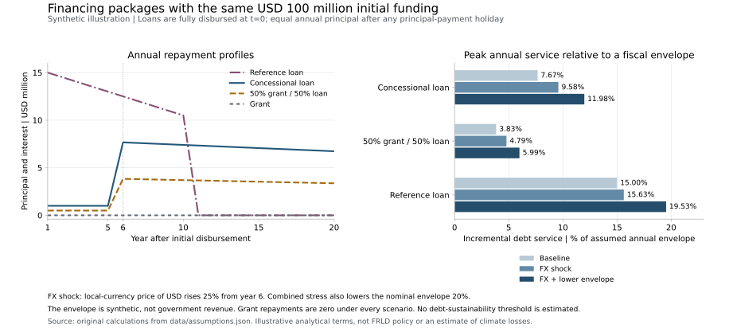

# Climate finance and economic appraisal

**Isaac Guzmán Valdivia Tovar · Economist · 26 October 2026**

These work samples examine the economic reasoning and evidence behind financing decisions for loss and damage response. They connect repayment and liquidity analysis with operational review and the interpretation of public financial reporting. Each states its assumptions, source dates and limits.

The three new studies are independent analytical work. They are not records of a client assignment or a financing operation, and imply no endorsement by the World Bank or the Fund for responding to Loss and Damage (FRLD). The numerical financing model uses synthetic inputs. The policy and reporting studies use identified official public documents.

## Start with the financing decision

| Work sample | Question and contribution | Read and inspect |
|---|---|---|
| **Financing packages and fiscal exposure** | How do grant and loan packages with equal initial funding differ in repayment, currency exposure and temporary liquidity needs? The model separates the present value of obligations from annual debt service and a delay in receiving funds. All terms and fiscal inputs are illustrative. | [Analytical note](../../projects/07-financing-instruments/NOTE.md) · [Inputs](../../projects/07-financing-instruments/data/assumptions.json) · [Code and reproduction](../../projects/07-financing-instruments/README.md) |
| **Access and fiduciary evidence** | What evidence connects a policy requirement to a defensible funding assessment? Eight dated policy-status records support twelve original analytical checks. Proposed evidence requests remain distinct from official requirements, and no applicant is assessed. | [Policy note](../../projects/06-frld-operational-review/POLICY_NOTE.md) · [Review matrix](../../projects/06-frld-operational-review/data/review_matrix.csv) · [Sources and validation](../../projects/06-frld-operational-review/README.md) |
| **Resources and funding requests** | What can a reader conclude from the Fund's published resource and pipeline figures? The analysis separates funding stages, preserves an internal source discrepancy and makes missing evidence visible. It uses a historical reporting snapshot, not a live cash balance. | [Analytical note](../../projects/08-frld-resource-reconciliation/NOTE.md) · [Data and reproduction](../../projects/08-frld-resource-reconciliation/README.md) |



The loan illustration is a comparison of possible financing mechanisms. The reviewed FRLD report describes the Barbados Implementation Modalities as grant interventions; the model does not turn its hypothetical loan terms into an available product. It does not determine country debt sustainability or funding eligibility.

## Earlier analytical work

**Airport investment planning and financing risks.** My [2022 commentary, “Transparencia, planeación e infraestructura aeroportuaria”](https://mexicocomovamos.mx/animal-politico/2022/04/transparencia-planeacion-e-infraestructura-aeroportuaria/), published by México, ¿cómo vamos? / Animal Político, examines planning information, demand and financing uncertainties in infrastructure investment. The original is in Spanish and reflects its publication date. It is a writing sample, not a claim that I structured the financing arrangements discussed.

**Investment and growth over different horizons.** The [growth-scenarios project](../../projects/05-growth-scenarios/README.md) extends my public teaching materials with a reproducible illustration of investment and efficiency-growth paths. It provides background on transition mechanisms and explicit assumptions. It is not a climate-damage model or a country forecast.

## Reproduce the three new samples

From the repository root, using Python 3.11 or later:

```bash
python reproduce_climate_finance.py
```

Core calculations and document-integrity checks require no credentials, network access or external packages. Optional figure generation is documented in the financing project. Each module includes its own source register and validation scope. Source retrieval and substantive review remain distinct from reproducing the bundled inputs.

[Full portfolio](../../README.md) · [Source guide](../../SOURCES.md) · [Execution and validation](../../VALIDATION.md)
