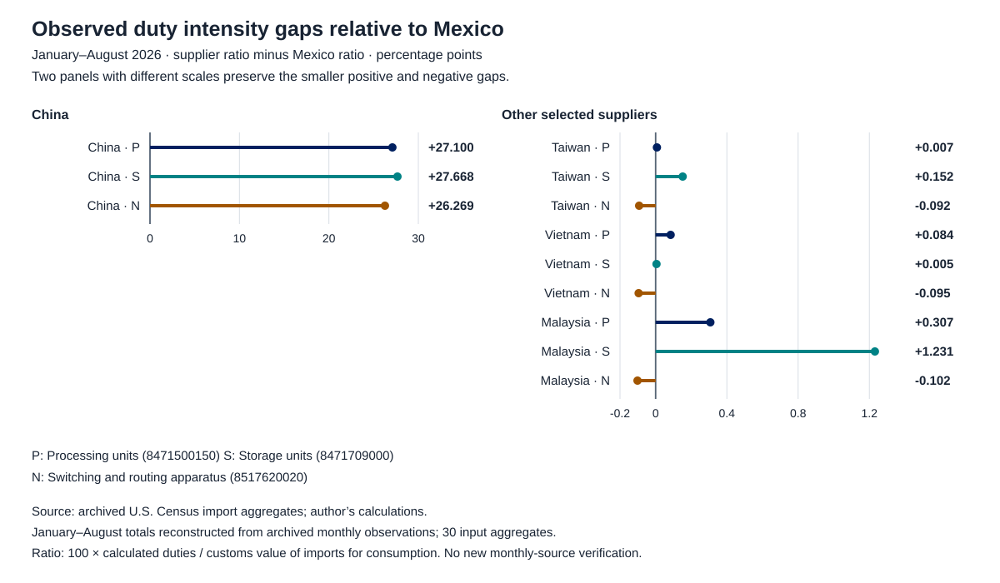

# Observed duties across suppliers of three equipment lines

Isaac Guzmán Valdivia Tovar · 22 October 2026

## Question and finding

How much does observed duty intensity differ across suppliers of the same equipment product? A comparison of three Harmonized Tariff Schedule 10-digit (HTS10) lines shows that the answer depends strongly on the supplier used as the benchmark. In January–August 2026, China's calculated-duty ratios exceeded Mexico's by 26.269–27.668 percentage points. Comparisons with Taiwan, Vietnam and Malaysia instead yielded gaps between −0.102 and +1.231 points. For switching and routing apparatus, Mexico's observed ratio was slightly higher than all three of those suppliers' ratios.

These results distinguish a large bilateral contrast with China from the much smaller differences among other selected suppliers. They do not establish the cause of trade growth, a legal entitlement to a preference or an amount of realized tariff savings. The contribution of this exercise is measurement: a reproducible comparison within exact product codes, with the denominator and statistical vintage held explicit.

## Sample and measurement

The reporting country is the United States, the flow is imports for consumption, and the origin partners are Mexico, China, Taiwan, Vietnam and Malaysia. The products are processing units (`8471500150`), storage units (`8471709000`) and switching and routing apparatus (`8517620020`). Labels are shortened; the exact codes define the selection. They form a bounded illustration inherited from prior analytical work, rather than a representative electronics sample. Their compatibility with computing or network uses does not establish their final use.

Both periods cover January–August, in 2025 and 2026. The input basis is **January–August totals reconstructed from archived monthly observations**. The supplied file contains 30 product–partner–period aggregates. Earlier documentation reports that the upstream extraction used 240 monthly observations; the present run neither receives nor revalidates those monthly records. It recalculates the results from the 30 aggregates and preserves their recorded vintage.

Observed duty intensity is 100 times calculated duties divided by the customs value of imports for consumption. All values in the numerator and denominator are nominal U.S. dollars. Aggregation requires adding duties and import values separately before division. A simple average of product rates would answer a different question. A supplier's gap relative to Mexico is its observed percentage rate minus Mexico's rate for the same product and period; the result is expressed in **percentage points**, not percent.

## Rates within each product

Percent of customs value; January–August in each year. All entries are calculated from the included archived aggregates.

| Product / HTS10 | Supplier | 2025 | 2026 |
| --- | --- | ---: | ---: |
| Processing units / 8471500150 | Mexico | 0.096 | 0.024 |
|  | China | 35.039 | 27.125 |
|  | Taiwan | 0.028 | 0.032 |
|  | Vietnam | 0.120 | 0.109 |
|  | Malaysia | 0.691 | 0.332 |
| Storage units / 8471709000 | Mexico | 0.274 | 0.002 |
|  | China | 33.963 | 27.670 |
|  | Taiwan | 0.335 | 0.154 |
|  | Vietnam | 0.168 | 0.007 |
|  | Malaysia | 1.161 | 1.233 |
| Switching / routing / 8517620020 | Mexico | 3.216 | 0.112 |
|  | China | 41.092 | 26.381 |
|  | Taiwan | 0.077 | 0.020 |
|  | Vietnam | 0.057 | 0.017 |
|  | Malaysia | 0.111 | 0.011 |

Source: archived U.S. Census Bureau import aggregates; author's calculations. Display rounding only. Exact values and denominators appear in `results/duty_intensity_by_line.csv`.

The 2026 processing-unit gap between Taiwan and Mexico was only 0.007 percentage points; the Vietnam–Mexico gap for storage was 0.005 points. Malaysia's storage-unit gap was larger, at 1.231 points. For switching and routing apparatus, the Taiwan, Vietnam and Malaysia gaps were −0.092, −0.095 and −0.102 points, respectively. A statement that Mexico uniformly faced the lowest observed duty burden would therefore be incorrect even within this small selection.

The chart deliberately uses different, labeled scales for China and the other suppliers. A common 30-point scale would conceal the small positive and negative gaps. Direct numerical labels allow comparison without treating the panels' visual lengths as equivalent.

## Changes over time and aggregation

The cross-section also needs a time dimension. Mexico's switching and routing ratio fell from 3.216% in 2025 to 0.112% in 2026, a decline of 3.104 percentage points. China's ratios declined across all three products, by 6.293–14.711 points. Such changes show why a low current ratio cannot establish that earlier tariff changes, expectations or delayed responses were irrelevant. They also do not identify which legal provisions generated the observed change.

Across the three selected products, Mexico's ratio of summed duties to summed values fell from 0.270% to 0.029%. China's corresponding ratio fell from 37.928% to 26.802%. These are valid summary statistics for each country's own observed mix. They are not fixed-basket tariff indices: processing units, storage and network equipment have different weights for each supplier and year. Within-product results provide the cleaner comparison for the question asked here. The separate P02 project studies trade composition and contributions rather than repackaging these duty ratios.

## Interpretation for policy analysis

The evidence supports considering supplier-specific differences when assessing exposure to U.S. trade policy. A large China–Mexico gap can coexist with low ratios for several alternative suppliers. This distinction matters when evaluating the claim that a tariff advantage uniquely favors Mexico. Observed duties describe the entries recorded under the statistical definitions; they cannot determine how firms rank tariff costs against capacity, delivery times, market access or other production decisions.

Census explains that calculated duty typically reflects the duty reported on the entry summary, including reported Chapter 99 duties when accepted. It is not necessarily the duty actually paid and excludes antidumping and countervailing duties. Consequently, it should not be presented as a legal schedule, final net customs revenue, evidence of trade-agreement eligibility, or proof of origin compliance. Establishing any of those claims requires separate legal or administrative evidence. [1]

The input also does not separate quantities from prices, domestic from imported value added, or productive capacity from changes in product mix within a tariff line. It neither proves nor rules out production relocation or transshipment. A descriptive association between duty gaps and gross trade changes would not resolve those identification problems.

## Reproduction and verification boundary

The accompanying Python script runs without network access or third-party packages. It checks the exact 30-cell coverage, unique keys, partner codes, finite nonnegative numeric values, positive denominators and the explicit period basis. It reproduces all line ratios, bilateral gaps, changes in points and country ratios of sums, and generates the figure from those outputs. The original snapshot's SHA256 hash is retained.

These are checks on the supplied aggregates and arithmetic. No fresh Census statistical download or independent check of the 240 underlying monthly observations was performed. Archived monthly vintages may differ from subsequently revised official year-to-date fields. This exercise therefore supports conclusions about its identified snapshot, while keeping the latest-release verification outside the completed scope.

## Sources

[1] U.S. Census Bureau, *Foreign Trade Statistics: Definitions*, sections 3 (types of imports), 6 (valuation, including calculated duty) and 18 (quality limitations). Available at: https://www.census.gov/foreign-trade/guide/sec2.html

[2] U.S. Census Bureau, *International Trade Imports HS: Variables*. Available at: https://api.census.gov/data/timeseries/intltrade/imports/hs/variables.html

Snapshot identity and shared field definitions: [sources.json](sources.json), [common dictionary](../census-common/DATA_DICTIONARY.md) and [common sources](../census-common/SOURCES.md).
