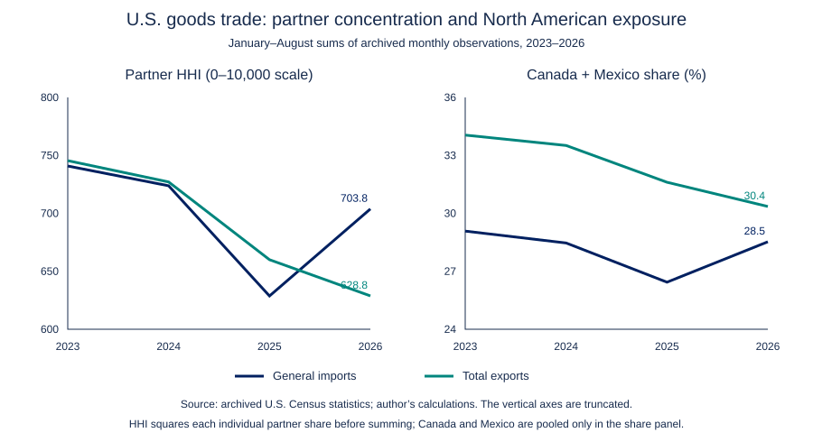

# Trade concentration and exposure: partners and products

**Isaac Guzmán Valdivia Tovar · 22 October 2026**

P02 contains two complementary perspectives with separate data, periods and denominators. Both use the Herfindahl–Hirschman Index (HHI) on a 0–10,000 scale, but their levels are not one comparable time series. Broader partner diversification can coexist with greater concentration within a selected product basket.

| View | Question and universe | Flow / period / denominator | Result and evidence |
|---|---|---|---|
| **A. Partners and North American exposure** | How concentrated are individual foreign suppliers and destinations across all reported goods? | U.S. general imports and total exports separately; January–August 2023–2026; each flow's retained individual-partner total | 2026 HHI 703.8 for imports and 628.8 for exports; [partner note](NOTE.md), [code](analyze.py), [dictionary](DICTIONARY.md) |
| **B. Selected products from Mexico** | How concentrated is a fixed retrospective selection of 374 historical ten-digit tariff lines grouped into 88 six-digit products? | U.S. general imports from Mexico; January–August 2025–2026; the selection's reported value, not all trade or all codes within those groups | HHI 2,853.1→4,289.0; three lines contribute 99.64% of the net increase; [product project](product-basket/README.md), [note](product-basket/NOTE.md), [code](product-basket/analyze.py) |

[Shared Census dictionary](../census-common/DATA_DICTIONARY.md) · [General/consumption flow bridge](../census-common/README.md). The bridge is support and is not another project. Its six differences compare definitions; they are not forced reconciliation errors.

## A. Partner concentration and North American exposure

**Question.** How concentrated are U.S. goods exports across destinations and imports across suppliers, and how much of this trade involves Canada and Mexico?

**Result.** In the archived January–August 2026 observations, the partner Herfindahl–Hirschman Index (HHI) is **703.8 for general imports** and **628.8 for total exports**, on a 0–10,000 scale. Canada and Mexico jointly account for **28.5% of covered imports** and **30.4% of covered exports**. Export destination concentration fell from 2023; North American export share also fell. These are different dimensions of exposure.

[Read the analytical note](NOTE.md) · [Results](results/concentration_summary.csv) · [Source record](sources.json)



## Scope

U.S. merchandise trade, all reported ten-digit products and all individual Census country partners; January–August of 2023, 2024, 2025 and 2026. General imports use customs value. Total exports include domestic exports and reexports, using free alongside ship (FAS) value. Imports and exports are analyzed separately. No sector selection or client-defined basket is included.

The 1,846 input rows are partner totals reconstructed upstream from **64 archived monthly product-level partitions**. The data preserve those monthly vintages; they are not a fresh download of revised year-to-date `_YR` totals. The included code reproduces the concentration/exposure calculations from the bounded partner extract. It does not recreate the upstream product-month extraction.

## Reproduce the partner view

Python 3.11+; standard library only; no credentials, network or external packages required.

```bash
python analyze.py
```

This command reproduces view A only. To reproduce both views and the flow bridge from the repository root, run `python reproduce.py`; or run `python projects/02-trade-concentration/product-basket/analyze.py` and `python projects/census-common/reconcile_flows.py` separately.

This works from any current directory. `--input` and `--output` accept alternative paths. It validates key uniqueness, periods, country-code scope, integer nonnegative dollar amounts, denominators and share/contribution sums, then generates five result files. The figure is a self-contained vector SVG.

## Files

| File | Content |
|---|---|
| `data/partner_values.csv` | Public-statistics partner totals; one flow–period–country row |
| `DICTIONARY.md` | Input, output and denominator definitions |
| `analyze.py` | New decimal-arithmetic implementation and vector chart |
| `results/concentration_summary.csv` | HHI, effective partners, top-five and North American shares |
| `results/partner_shares.csv` | Every individual partner's share and HHI contribution |
| `results/growth_contributions_2025_2026.csv` | Signed partner contributions to nominal net change |
| `results/concentration_exposure.svg` | Concentration and North American shares, with truncated axes disclosed |
| `results/validation.json` | Input hash and executed checks |
| `NOTE.md` | Question, findings, interpretation and limits |
| `sources.json` | Official definitions, archive provenance and upstream recorded hashes |
| `REFRESH.md` | Official query scope, exclusions and procedure for a new source vintage |
| `EXECUTION.md` | Checks executed and verification limits |

## Interpretation

HHI measures concentration **across individual suppliers or destinations**, not product concentration, market power or North American domestic value added. Regional aggregates and world totals are excluded from the partner denominator. Canada and Mexico are pooled only for the separate regional share; their squares remain separate in HHI. Census partner codes include separately reported territories/economies and are not a count of sovereign states.

This is a U.S.-reported view of North American trade exposure. It does not measure Mexico's or Canada's total dependence on the United States, all intra-regional trade, origin compliance or imported content. It establishes no causal tariff effect or transshipment mechanism.

Original employer analysis/code is excluded. New prose/code and the bounded public-statistics extract form this sample. Source conditions and release review are recorded at the portfolio level.
