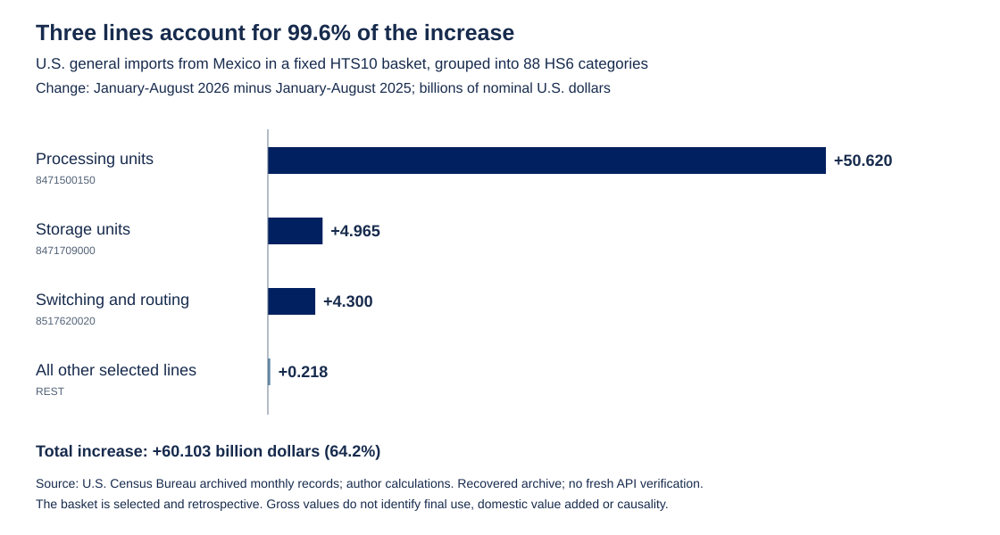

# A growing trade flow with a narrower product base

**Composition, concentration and contributions within a fixed U.S. general-import basket from Mexico**  
Isaac Guzmán Valdivia Tovar · October 22, 2026  
January–August 2025 and 2026 · Nominal U.S. dollars

## Question and finding

How much of the expansion in a selected U.S. import basket from Mexico comes from a small number of products? The answer matters for monitoring the durability of export growth and its exposure to changes in product demand. A large aggregate increase can coexist with a narrower base of activity. Product concentration describes that exposure; it does not establish how much domestic income the trade generates.

Within the fixed research basket examined here, U.S. general imports from Mexico increase from **93.602 billion dollars in January–August 2025 to 153.705 billion dollars in the same months of 2026**. The **60.103 billion dollar increase**, or **64.21%**, is overwhelmingly concentrated in three ten-digit tariff lines. Processing units contribute 50.620 billion dollars; storage units contribute 4.965 billion dollars; and switching and routing apparatus contributes 4.300 billion dollars. Together, they account for **99.64% of the net increase**. The remaining selected lines add 0.218 billion dollars in net terms.

| Selected component | 2025 value | 2026 value | Absolute change | Share of net change |
| --- | ---: | ---: | ---: | ---: |
| Processing units, 8471500150 | 48.774 | 99.393 | +50.620 | 84.22% |
| Storage units, 8471709000 | 1.954 | 6.919 | +4.965 | 8.26% |
| Switching and routing, 8517620020 | 2.908 | 7.209 | +4.300 | 7.15% |
| All other selected lines | 39.966 | 40.184 | +0.218 | 0.36% |
| **Fixed basket total** | **93.602** | **153.705** | **+60.103** | **100.00%** |

Values and changes are billions of nominal dollars. Percentages use the basket's net dollar change as denominator. Independently rounded entries may not add exactly. Source: U.S. Census Bureau archived monthly records; author calculations.

## The concentration result

The product **Herfindahl–Hirschman Index (HHI)** rises from **2,853.09 to 4,289.04** on a 0–10,000 scale. This index sums squared shares after the selected ten-digit lines have been grouped into 88 six-digit categories. Its denominator is the total reported value of this fixed selection in each year. It therefore measures concentration across the selected product groups, not across suppliers, destinations or the entire U.S. import market. The increase remains descriptive: it is not an antitrust finding and no market-power threshold is applied.

Processing units alone rise from **52.11% to 64.66%** of the basket's value. This shift explains why a fast-growing aggregate becomes more concentrated. The HHI's inverse, expressed as an equivalent number of equally sized groups, falls from about **3.50 to 2.33**, despite 88 selected categories having reported trade in both windows. That transformation is an intuitive summary of value concentration, not a claim that only two or three categories actually trade.

## Population, selection and method

The reporter is the United States and the partner is Mexico, identified by Census code `2010`. The flow is **general imports**. The public selection file specifies 374 historical Harmonized Tariff Schedule ten-digit (HTS10) codes, which fall within 88 Harmonized System six-digit (HS6) categories. It includes goods used in computing, storage, communications, power supply, cooling and other infrastructure. Many also serve other activities. Compatibility with a data center is not evidence of actual final use.

Membership is fixed by the published code list. It is not defined by selecting the largest contributors after this calculation, and the three leading lines are components of the larger fixed basket rather than its denominator. However, the basket was assembled in prior retrospective research: it was not preregistered or randomly sampled. The present note does not establish the timing of all original selection judgments. Accordingly, it makes no inference to all electronics, all investment goods or all Mexican exports, and does not describe the basket as every tariff line within its 88 HS6 categories. New codes outside the frozen list remain excluded. Retired codes in the list remain visible in the selection history; grouping at HS6 reduces sensitivity to changes in the ten-digit code structure but does not constitute a complete official concordance audit.

The recovered input contains **4,794 reported monthly observations** spanning January–August in each year. Keys are month, HTS10 and partner. The code checks uniqueness, membership, country, flow, nonmissing nonnegative amounts and the 16 distinct month-periods. It sums integer dollar values by product and year before calculating shares. HHI is `10,000 × sum(product_share²)`. A component's contribution to net change is its dollar change divided by the basket's total dollar change; its contribution to aggregate growth, in percentage points, instead divides by the 2025 total. These denominators are distinct. Signed contributions are preserved and can exceed 100% when other components decline.

The data are sparse: 328 ten-digit lines have reported values in 2025, 344 in 2026 and 356 across the two windows. An absent record is not filled with zero. The line-level output shows the number of reported months and retains a blank amount when an entire period lacks records. Accounting contributions compare sums of reported values, with availability flags. All 88 selected HS6 groups have reported values in both annual windows. Neither that coverage check nor reconciliation to the archived ranking proves complete current official coverage of every possible code-month.

## What this can help monitor

The decomposition identifies where further country analysis would be most informative. A slowdown in processing-unit demand would affect a much larger share of this basket than an equally sized percentage slowdown in a smaller category. Product-specific order books, capacity, employment and investment could help distinguish a temporary shipment surge from a sustained expansion. Watching the residual separately can also reveal whether growth is broadening beyond the three leading lines. Those are monitoring uses of a descriptive result, not tests already executed here.

The note does not identify tariffs as a cause, determine the domestic value added in Mexican production, separate prices from quantities, or show that imports are diverted through another country. It uses one U.S.-reported bilateral import flow and does not add mirror flows. It cannot reconstruct a production chain from trade totals alone. [P01](../../01-observed-duty-intensity/README.md) answers a different question using calculated duties and **imports for consumption**; those values are not interchangeable with the general imports used here. The [other perspective within P02](../NOTE.md) measures concentration across individual foreign partners for all goods in 2023–2026. Its denominator is also different: falling partner concentration can coexist with rising product concentration in the selected basket.

## Vintage and reproducibility

The figures are **January–August totals reconstructed from archived monthly observations**. The archive was recovered on October 22, 2026, without rerunning a Census downloader. This date is the recovery date, not proof of the original download date. Original archive hashes and sanitized input hashes are recorded in `sources.json`; the frozen basket's original hash agrees with the archived source manifest. The new script reproduces composition, concentration, contributions and the figure using the bundled panel and Python's standard library. It does not download fresh `_YR` fields or certify the latest official vintage. It also does not revalidate P01's separately documented 240 monthly consumption observations.

Official definitions and variables are documented in the U.S. Census Bureau's [statistical definitions](https://www.census.gov/foreign-trade/guide/sec2.html), [HS imports variables](https://api.census.gov/data/timeseries/intltrade/imports/hs/variables.html) and [Guide to International Trade Datasets](https://www.census.gov/foreign-trade/reference/guides/Guide_to_International_Trade_Datasets.pdf). Exact unrounded values and the checks actually executed are provided with the code.
