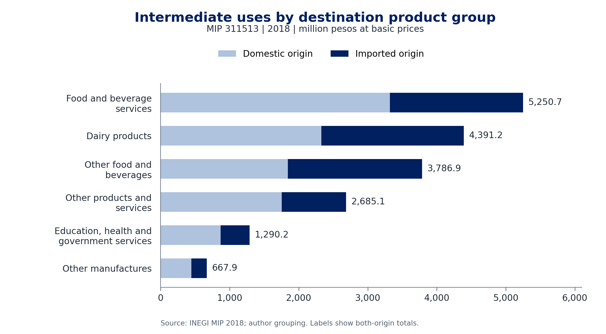

# Mexico's dairy-product uses and imported-origin exposure

Isaac Guzmán Valdivia Tovar | Original project: 22 October 2026 | Reviewed: 26 October 2026 | **Data year: 2018**

**Question.** How does imported-origin exposure differ between intermediate and total uses of Mexico's dairy-derivatives category, and which destination product groups account for its intermediate demand?

**Finding.** In the 2018 symmetric input-output matrix, imported-origin products account for **41.5% of intermediate uses** of category 311513 and **17.5% of all gross uses**. Food and beverage services, dairy products, and other food and beverages account for **74.3% of intermediate uses**. These accounting allocations identify links to investigate when evaluating a product-specific trade-policy change. They do not estimate substitution, compliance costs, price transmission or output responses.

[Three-page note (PDF)](NOTE.pdf) | [Editable note](NOTE.md) | [Source register](sources.json) | [Dictionary](data/DICTIONARY.md) | [Executed validation](VALIDATION.md)

## Read each percentage with its denominator

Amounts below are **millions of pesos at basic prices for 2018**. Ratios use unrounded values.

| Measure | Numerator | Denominator | Result |
|---|---:|---:|---:|
| Imported-origin share of intermediate uses, MIP 311513 | Imported intermediate uses: 7,507.129 | Intermediate uses of both origins: 18,072.048 | **41.5%** |
| Imported-origin share of all gross uses, MIP 311513 | All imported-origin uses: 21,761.015 | All gross uses of both origins: 124,245.757 | **17.5%** |
| Intermediate share of imported-origin uses, MIP 311513 | Imported intermediate uses: 7,507.129 | All imported-origin uses: 21,761.015 | **34.5%** |
| Intermediate share of all gross uses, MIP 311513 | Intermediate uses: 18,072.048 | All gross uses: 124,245.757 | **14.5%** |
| Intermediate share of total uses, separate COU 3115 | Intermediate uses: 44,212.476 | Total uses: 251,870.392 | **17.6%** |

**The 17.6% is the intermediate-use share of another, broader category. It is not another imported-origin proportion.** MIP 311513 and COU 3115 remain separate statistical universes.

Final uses account for 85.5% of MIP 311513 gross uses and have an imported-origin share of 13.4%. This composition explains the lower aggregate imported share. “Gross uses” means uses before the combined table's negative imports adjustment; it includes exports and signed inventory changes. It is not domestic absorption or imported content in production.

## Statistical scope

The National Institute of Statistics and Geography (INEGI) supplies the data. MIP denotes *Matriz de Insumo Producto*; COU denotes *Cuadros de Oferta y Utilización*. SCIAN denotes the North American Industry Classification System, Mexico 2018.

| Attribute | Main exercise: MIP | Separate comparison: COU |
|---|---|---|
| Reference year / base year | 2018 / 2018 | 2018 / 2018 |
| Official category | **311513 - Elaboración de derivados y fermentos lácteos** | **3115 - Elaboración de productos lácteos** |
| Classification level | Six-digit SCIAN class associated with a product category | Four-digit SCIAN branch, broader product category |
| Matrix | Symmetric, product by product | Supply-and-use: product by user industry |
| Row meaning | Uses of the 311513 product category | Uses of the broader 3115 product category |
| Intermediate-column meaning | Homogeneous destination product groups | User industries |
| Extract coverage | All 834 intermediate destinations for each of three origins, plus final components and control totals | Final components and control totals only; no industry-level destination vector included |
| Valuation / units | Basic prices; million pesos for 2018 | Basic prices; million pesos at 2018 prices |
| Workbook metadata update | 29 August 2023 | 29 August 2023 |

The 2,557-cell extract preserves every zero, source file, sheet and cell coordinate. There are 89 positive and 745 zero combined-origin intermediate destinations. Domestic (D), imported (M) and combined (T) are overlapping presentations: **D + M = T** for comparable flows; they are never summed as three independent origins. The combined MIP final block includes a negative imports entry and requires the bridge described below.

The row measures uses of a product, not the composition of all inputs used to produce it. It does not identify firms, retail channels, named cheeses or the country of origin of imports. A within-group imported share refers only to the group's uses of **311513**, not to its entire input-cost structure. The 2026 review date does not turn these data into a 2026 observation.

## Reproduce

### Core tables: offline, standard library only

Python 3.11 or later. No credentials or network access are needed for the included extract. From this directory:

```bash
python analyze.py
```

The entry point also works from any other working directory when invoked by path. It regenerates the same four CSV tables and `results/validation.json`. All validations use explicit exceptions and remain active under `python -O`; output files are staged only after all accounting and structural checks pass.

### Note and figure

Install the optional presentation dependencies once, then use the same entry point:

```bash
python -m pip install -r requirements-publication.txt
python analyze.py --publication
```

This also creates `NOTE.md`, the three-page `NOTE.pdf`, and the figure in PNG and SVG. `build_publication.py` reads the result CSVs; numerical prose, tables and figure labels are generated from those values. Edit its prose blocks and rebuild to keep both note formats aligned. `results/publication_manifest.json` records the input/output hashes; it does not substitute for visual review.



The figure separates domestic and imported origin across six exhaustive analytical groups. The CSV retains the exact editable values; SVG preserves a scalable vector version.

### Exact re-extraction from official workbooks

**Closed on 26 October 2026:** all six workbooks were freshly downloaded from INEGI, all six SHA256 hashes matched the archived binaries, and all 2,557 selected values matched the extract. The [dated source-recovery record](data/source_recovery_20261026.json) retains effective URLs, actual consultation times, titles, metadata and comparison scope. No source revision was detected. The historical [workbook provenance](data/workbook_provenance.json) remains byte-identical.

Download the six files under their recorded names:

| Workbook | Origin | Official download |
|---|---|---|
| `MIP_19.xlsx` | Domestic | [INEGI XLSX](https://www.inegi.org.mx/contenidos/programas/mip/2018/tabulados/ori/MIP_19.xlsx) |
| `MIP_38.xlsx` | Imported | [INEGI XLSX](https://www.inegi.org.mx/contenidos/programas/mip/2018/tabulados/ori/MIP_38.xlsx) |
| `MIP_10.xlsx` | Combined | [INEGI XLSX](https://www.inegi.org.mx/contenidos/programas/mip/2018/tabulados/ori/MIP_10.xlsx) |
| `COU_177.xlsx` | Domestic | [INEGI XLSX](https://www.inegi.org.mx/contenidos/programas/cou/2018/tabulados/ori/COU_177.xlsx) |
| `COU_184.xlsx` | Imported | [INEGI XLSX](https://www.inegi.org.mx/contenidos/programas/cou/2018/tabulados/ori/COU_184.xlsx) |
| `COU_170.xlsx` | Combined | [INEGI XLSX](https://www.inegi.org.mx/contenidos/programas/cou/2018/tabulados/ori/COU_170.xlsx) |

Place them in `SOURCE_DIRECTORY`, then run:

```bash
python extract_cells.py SOURCE_DIRECTORY --output REEXTRACTED
python tests/test_validation.py --source-directory SOURCE_DIRECTORY --report test_results.json
```

The extractor checks **all six hashes against the pinned register before parsing or replacing anything**. It rejects missing or changed binaries with a clear error and preserves the existing snapshot. Without `--output`, it targets `data/`; an isolated destination is recommended for comparison. It also checks source metadata, categories and all extracted accounting identities. An unexpected source version must be reviewed separately; changing the pinned hashes is not an automatic update procedure.

Without the six workbooks, `python tests/test_validation.py` runs ten cases, including rejection of deliberately invalid byte fixtures, and reports that exact official extraction was not run. The delivered validation records the full **12 cases actually executed** with the six exact official files.

## Reconciliation and analytical limits

The combined MIP final total is reconciled as:

**84,412.694 - (-21,761.015) = 106,173.709 million pesos of gross final uses.**

Adding 18,072.048 of intermediate uses gives 124,245.757 of gross uses. The negative imports entry reconciles a presentation; it is not another demand flow. Inventory change remains **-162.465**, including in final-use and gross-use totals.

A policy extension would require the affected tariff lines and countries of origin of imports, an explicit product concordance, specifications and substitution possibilities, compatible prices and quantities, capacity, contracts, compliance costs and each user's input-cost shares. A current assessment also needs evidence on changes since 2018. The row extract supports no Leontief inverse, causal effect, welfare estimate or general-equilibrium result; none is needed to close this accounting exercise.

## Files and attribution

| File or directory | Purpose |
|---|---|
| `NOTE.md`, `NOTE.pdf` | Original English policy note, identical substantive content |
| `analyze.py`, `extract_cells.py` | Offline accounting entry point and exact-source extractor |
| `build_publication.py`, `requirements-publication.txt` | Reproducible note and figure, with optional dependencies |
| `tests/test_validation.py` | Isolated valid/adverse checks, normal and optimized Python |
| `data/official_cells.csv` | Unchanged, public 2,557-cell statistical extract |
| `data/workbook_provenance.json` | Unchanged historical workbook identities |
| `data/source_recovery_20261026.json` | Fresh official binary and selected-cell verification |
| `data/DICTIONARY.md` | Universes, fields, grouping rules and denominators |
| `results/origin_and_uses.csv` | Origin-use decomposition |
| `results/intermediate_destination_groups.csv` | Six destination groups and within-group origin shares |
| `results/final_uses.csv` | Signed final-account components |
| `results/universe_comparison.csv` | MIP 311513 and COU 3115 as separate rows |
| `results/validation.json`, `results/publication_manifest.json` | Execution summary and publication hashes |
| `figures/` | One figure, PNG and SVG |
| `sources.json`, `VALIDATION.md` | Source history and actual verification scope |

Source: INEGI, [MIP 2018](https://www.inegi.org.mx/programas/mip/2018/) and [COU 2018](https://www.inegi.org.mx/programas/cou/2018/), metadata update 29 August 2023. Extraction, aggregation, translation, code and analysis are the author's own. The project is independent and implies no INEGI or International Monetary Fund endorsement. Official source statistics and descriptions retain their own terms; see [INEGI reuse terms](https://www.inegi.org.mx/inegi/terminos.html) and the repository's [rights and sources policy](../../RIGHTS_AND_SOURCES.md). No employer/client materials or full official workbooks are redistributed here.
