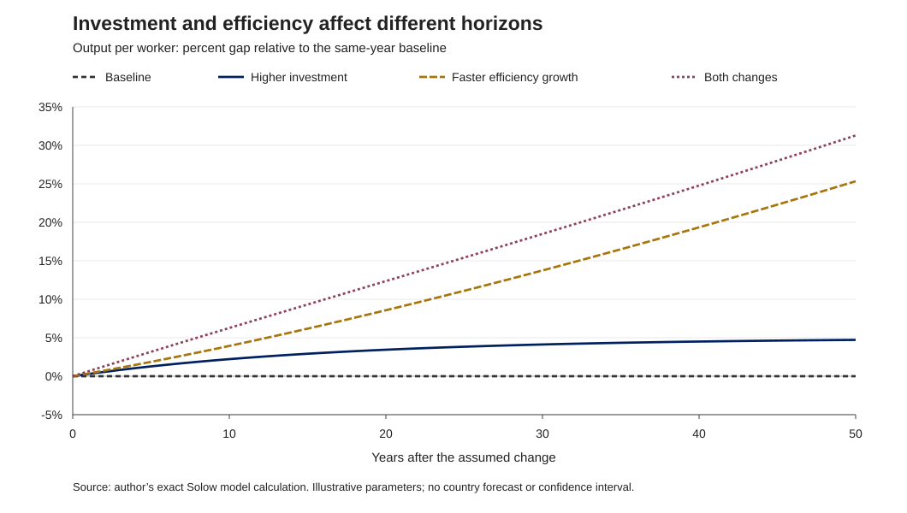

# Growth scenarios: investment, efficiency and the policy horizon

Isaac Guzmán Valdivia Tovar · 22 October 2026

**Question.** How do a higher investment share and faster labor-augmenting efficiency growth affect the level and growth of output per worker, and how does the comparison change with the policy horizon?

**Result.** In this illustrative Solow model, raising the investment share from 24.9% to 27.9% increases output per worker by 3.83% relative to baseline after 25 years; increasing efficiency growth by 0.5 percentage points gives an 11.10% gap. The investment-only scenario has an immediate consumption cost and the same long-run growth rate as baseline. These are conditional model comparisons, not forecasts or estimated reform effects for Mexico.

[Read the analytical note](NOTE.md) · [View results](results/scenario_summary.csv) · [Sources and relationship to prior work](SOURCES.md)



## Reproduce

Python 3.11 or later; standard library only. No network, external data, credentials, R installation or package installation is required.

```bash
python projects/05-growth-scenarios/analyze.py
```

Run from the portfolio root, or execute `python analyze.py` inside this project. The script resolves files relative to its own location and overwrites the four files in `results/`. Read [the execution record](EXECUTION.md) for what was actually checked.

## Scope and provenance

The model is developed in the author's existing public [Crecimiento teaching repository](https://github.com/iguzmanvt/Crecimiento), inspected at [commit 3d67d7d](https://github.com/iguzmanvt/Crecimiento/commit/3d67d7dc98edaccbac9333be9839d0084bc5da3b). This project adds a fresh exact transition implementation, four parameter scenarios, reproducible tables and an English explanation. It does not present a new empirical estimate. The original repository and its history are unchanged; its course files, third-party figures and code are not republished here.

| File | Content |
|---|---|
| `NOTE.md` | Mechanism, numerical comparisons and policy interpretation |
| `data/parameters.json` | All illustrative assumptions and four scenarios |
| `DATA_DICTIONARY.md` | Parameter and output definitions, units and denominators |
| `analyze.py` | Exact transition, calculations, validation and SVG generation |
| `results/paths.csv` | 204 annual model observations: four scenarios × 51 years |
| `results/scenario_summary.csv` | Comparisons at years 10, 25 and 50 |
| `results/output_gaps.svg` | Output gap paths relative to the same-year baseline |
| `results/validation.json` | Input hash, coverage and analytical consistency checks |
| `SOURCES.md` | Pinned prior work, foundational attribution and rights treatment |
| `EXECUTION.md` | Execution and visual verification record |

## Limits

Parameters are illustrative and not re-estimated from country data. Investment and efficiency assumptions are imposed; the model does not explain which policy would achieve them. It omits fiscal financing, international borrowing, trade, unemployment, distribution, uncertainty and endogenous innovation. Consumption comparisons are accounting outcomes, not a welfare ranking. Scenario lines are not confidence intervals.
