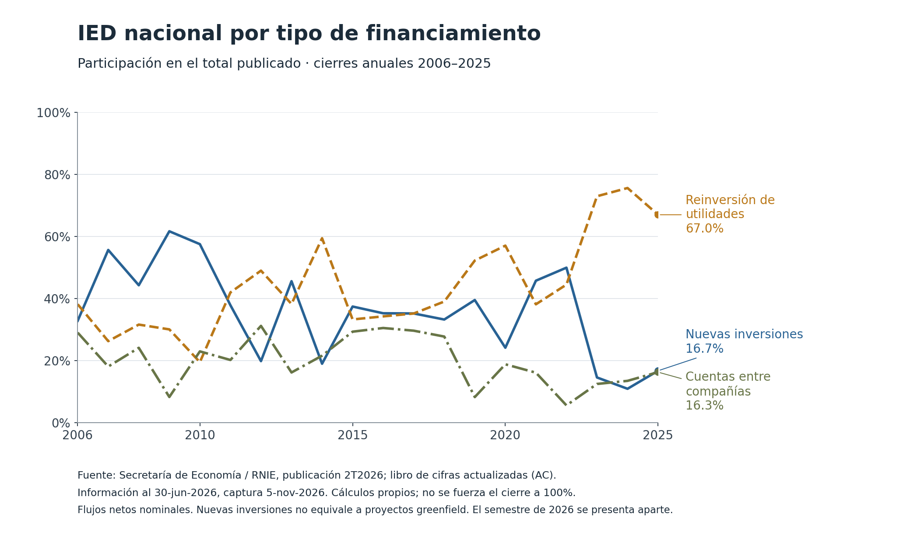
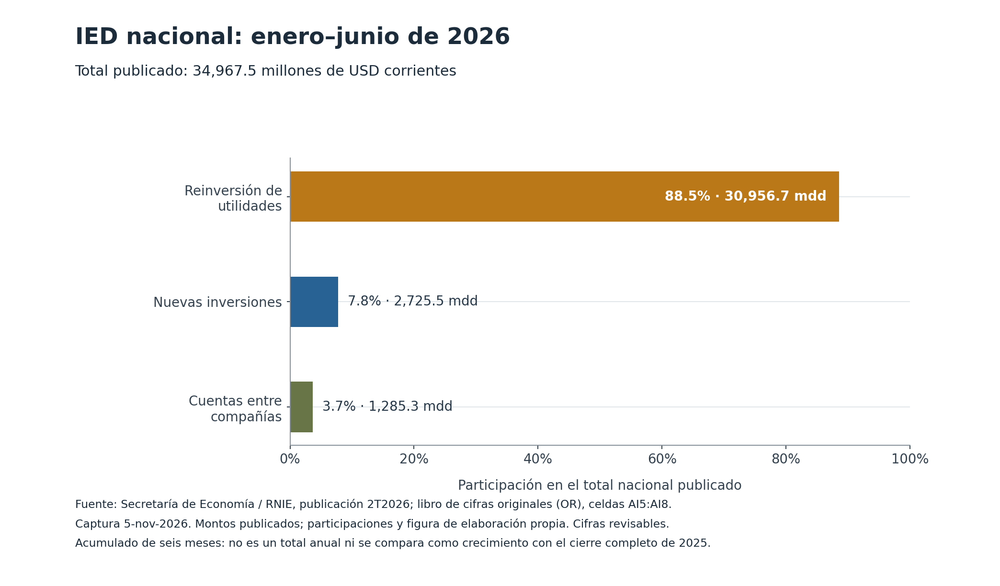

# IED en México: composición financiera y lectura de los cambios

**Isaac Guzmán Valdivia Tovar · 13 de noviembre de 2026**  
Edición estadística conservada: publicación 2T2026, recuperada el 5-nov-2026.

La reinversión de utilidades representó **67.0% de la inversión extranjera directa (IED) de México en 2025** dentro de la edición analizada. Sin embargo, su monto fue menor que en 2024. El total aumentó 10.40%, impulsado aritméticamente por nuevas inversiones y cuentas entre compañías. Esta combinación muestra por qué conviene distinguir el componente más grande del que explica el cambio de un año a otro. [1]

La muestra reúne veinte cierres nacionales revisados de 2006 a 2025. Las cifras provienen de la Secretaría de Economía (SE), a partir del Registro Nacional de Inversiones Extranjeras (RNIE), y se expresan en millones de dólares estadounidenses corrientes. Se conserva aparte una fotografía del acumulado enero–junio de 2026, tomada del libro de cifras originalmente publicadas de la misma publicación. La separación permite consultar ambos cortes sin convertir seis meses en un año ni tratar diferentes estados de revisión como una sola serie. [1–2]

## El tamaño de un componente y su aporte al cambio

El total nacional pasa de **37,969.2 millones de dólares en 2024 a 41,916.7 millones en 2025**. La diferencia es 3,947.5 millones. Nuevas inversiones aumenta 2,865.7 millones y cuentas entre compañías, 1,708.3 millones; reinversión disminuye 626.5 millones. Las variaciones se calculan con las cifras sin redondear de ambos cierres del libro actualizado. [1]

| Componente | Monto 2025, millones de USD | Participación 2025 | Cambio 2024–2025, millones de USD | Aporte al crecimiento del total |
|---|---:|---:|---:|---:|
| Nuevas inversiones | 7,009.9 | 16.72% | +2,865.7 | +7.55 pp |
| Reinversión de utilidades | 28,083.8 | 67.00% | −626.5 | −1.65 pp |
| Cuentas entre compañías | 6,823.0 | 16.28% | +1,708.3 | +4.50 pp |
| **Total publicado** | **41,916.7** | **100.00%** | **+3,947.5** | **10.40% de crecimiento** |

Fuente: [1], hoja «Por Tipo de Inversión», celdas BY5:BY8 y CC5:CC8; cálculos propios en [annual_changes.csv](results/annual_changes.csv) y [annual_shares.csv](results/annual_shares.csv). Los aportes son puntos porcentuales (pp) del crecimiento de la IED total, no del producto interno bruto. La fila total es control y denominador; no se suma como un cuarto componente. El redondeo visible puede afectar sumas presentadas.

La historia de participaciones muestra cambios de composición sin asignarles una causa. En 2025, nuevas inversiones y cuentas entre compañías tienen pesos cercanos; reinversión conserva el mayor. Una participación elevada puede coexistir con una caída del monto si el resto del total también cambia. Por eso el análisis presenta tanto cocientes como diferencias monetarias, con denominadores explícitos.

## Qué representa la clasificación

Las categorías describen formas de financiamiento notificadas. Nuevas inversiones puede incluir inversiones iniciales, aportaciones de capital y transmisión de acciones, por lo que no equivale a proyectos nuevos de instalación —*greenfield*— ni a inversión física. Reinversión corresponde a utilidades no distribuidas; cuentas entre compañías, a relaciones de deuda dentro del grupo empresarial. Las definiciones y la naturaleza revisable de la estadística están documentadas por el productor. [3]

La composición ofrece una entrada para investigar decisiones de financiamiento y permanencia de inversionistas. Para evaluar ampliación de capacidad, empleo, productividad o relocalización se necesitaría evidencia adicional sobre destinos del gasto, proyectos, operaciones corporativas y actividad de las empresas. Estos datos agregados no permiten identificar esos resultados ni atribuirlos a una política específica.

## El semestre de 2026 se consulta por separado

El libro de cifras originalmente publicadas registra **34,967.5 millones de dólares en enero–junio de 2026**. Reinversión aporta 30,956.7 millones, equivalentes a 88.5% del total; nuevas inversiones, 2,725.5 millones y 7.8%; cuentas entre compañías, 1,285.3 millones y 3.7%. Las participaciones son cálculos propios sobre ese mismo acumulado. [2]

Esta fotografía no se agrega a la gráfica anual. Su composición semestral tampoco establece por sí sola un cambio estructural respecto de años completos: difieren la cobertura temporal y el estado de revisión. La muestra no calcula una tasa de crecimiento entre 2025 anual y el semestre de 2026, ni extrapola un resultado para todo 2026.

## Cálculo, procedencia y alcance

Para cada periodo, la participación es `100 × componente / total publicado`. El aporte anual al crecimiento del total es `100 × cambio del componente / total del año anterior`. Las cifras conservan sus valores decimales de origen. Los residuos entre el total y la suma de componentes se registran, sin forzar el cierre a cero o a 100% ni imputar una explicación. Los cálculos son descriptivos y nominales; no ajustan por inflación o variaciones cambiarias.

Las 84 cifras nacionales y sus localizadores se recuperaron de un extracto archivado, fijado por hash. En esta preparación se comprobó la identidad del extracto, se separaron ambos segmentos y se reprodujeron los resultados con un auditor independiente. La recuperación de los libros oficiales corresponde al 5 de noviembre de 2026; no se realizó una nueva descarga en esta entrega. La [validación](VALIDATION.md) distingue ambos alcances. Esta es una edición histórica reproducible, no una garantía de actualidad permanente.

## Fuentes

1. SE/RNIE, publicación 2T2026, [libro de cifras actualizadas por tipo](https://www.gob.mx/cms/uploads/attachment/file/1100604/2026_2T_Flujos_TI_AC_3.xlsx), hoja «Por Tipo de Inversión», cierres año-4 de 2006–2025; celdas BY5:BY8 para 2024 y CC5:CC8 para 2025. Información al 30-jun-2026. Localizadores de cada cifra en [data/annual_2006_2025.csv](data/annual_2006_2025.csv).
2. SE/RNIE, misma publicación, [libro de cifras originalmente publicadas por tipo](https://www.gob.mx/cms/uploads/attachment/file/1100605/2026_2T_Flujos_TI_OR_2.xlsx), hoja «Por Tipo de Inversión», AI5:AI8, registro 2026-2. Localizadores en [data/snapshot_2026s1.csv](data/snapshot_2026s1.csv).
3. Comisión Nacional de Inversiones Extranjeras, [informe 2T2026](https://gaceta.diputados.gob.mx/PDF/66/2026/sep/InvExt-20260929.pdf), secciones 4.1–4.3, páginas impresas 14–15/PDF 15–16; revisiones en sección 4.8, página impresa 17/PDF 18. Referencia conceptual y localizadores conservados del registro de revisión anterior; el PDF no se volvió a descargar para esta preparación.

Los hashes, las fechas de recuperación anteriores y las condiciones de atribución se conservan en [sources.json](data/sources.json). Extracción numérica parcial, análisis, código y figuras de elaboración propia; sin aval institucional.
