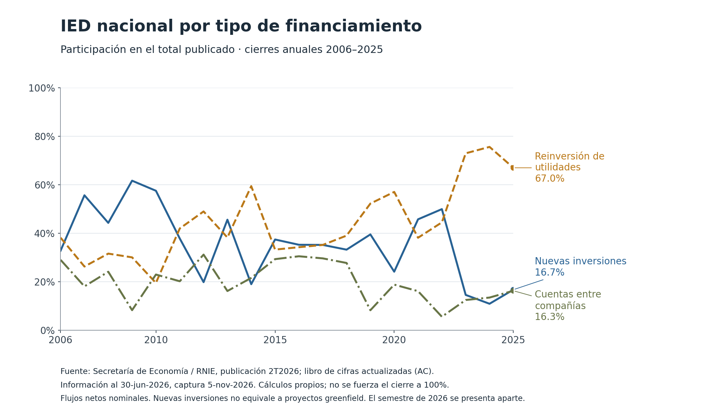

# IED en México: composición financiera y lectura de los cambios

**Isaac Guzmán Valdivia Tovar · Análisis económico independiente · 13 de noviembre de 2026**

Esta muestra examina cómo cambia la composición de la inversión extranjera directa (IED) nacional y qué aporta cada componente al cambio del total. Reúne **84 cifras publicadas** de la Secretaría de Economía (SE), a partir del Registro Nacional de Inversiones Extranjeras (RNIE): veinte cierres anuales 2006–2025 y, en un archivo separado, el acumulado enero–junio de 2026.

En la edición conservada, la reinversión de utilidades representa **67.0% de la IED de 2025**, pero su monto disminuye frente a 2024. El aumento del total procede aritméticamente de nuevas inversiones y cuentas entre compañías. La composición y el cambio son preguntas distintas. Estos resultados describen fuentes de financiamiento registradas; no identifican creación de capacidad física, proyectos anunciados ni efectos causales de políticas.

[Leer la nota en español](NOTE.md) · [English summary](SUMMARY_EN.md) · [Fuentes y metadatos](data/sources.json) · [Validación ejecutada](VALIDATION.md)



| Segmento | Cobertura | Estado de la fuente | Entrada |
|---|---|---|---|
| Historia anual | 2006–2025, 80 cifras: tres componentes y un total por año | Libros de cifras actualizadas (AC), información al 30-jun-2026 | [CSV anual](data/annual_2006_2025.csv) |
| Fotografía semestral | Enero–junio de 2026, cuatro cifras | Libro de cifras originalmente publicadas (OR), registro 2026-2 | [CSV semestral](data/snapshot_2026s1.csv) |

La unidad es millones de dólares estadounidenses corrientes. Cada cifra conserva libro, hoja, celda y etiqueta. Los segmentos no se empalman; el semestre no se anualiza ni se compara como crecimiento con un año completo. Se conserva la publicación 2T2026 recuperada el 5-nov-2026: **no es un servicio de actualización en tiempo real ni una afirmación sobre la última edición disponible**.

## Reproducir

Python 3.10 o posterior. Los cálculos, el auditor y las pruebas principales utilizan la biblioteca estándar, sin credenciales ni red. Ejecute desde esta carpeta y elija destinos nuevos fuera de ella:

```bash
python -B analyze.py --output ../ied_results
python -B verify.py --results ../ied_results
python -B -m unittest discover -s tests -v
python -B -O -m unittest discover -s tests -v
python -B verify_manifest.py
```

Los cuatro CSV reproducidos deben coincidir por bytes con los de `results/`; el recibo de cálculo también es determinista. `verify.py` recalcula las 160 filas de resultados con aritmética racional, sin importar el constructor. El constructor usa aritmética decimal, fija las entradas por SHA-256 y rechaza cambios de cobertura o metadatos antes de escribir. Un destino ocupado se conserva y produce un error.

Las dos figuras requieren la versión de matplotlib indicada en [requirements-figures.txt](requirements-figures.txt). Con esa dependencia disponible:

```bash
python -B build_figures.py --results ../ied_results --output ../ied_figures
```

El generador audita primero los resultados y produce SVG y PNG. Se incluyen dos figuras, no cuatro análisis distintos. La prueba específica del generador se omite expresamente si matplotlib no está instalado; en la revisión registrada sí se ejecutó. Los binarios de imagen pueden variar entre entornos de renderizado.

## Leer la evidencia

Las participaciones usan el **total nacional publicado**, no una suma normalizada. Los residuos exactos permanecen en [reconciliation.csv](results/reconciliation.csv), sin distribuirlos ni atribuirles una causa. Las tasas anuales se calculan únicamente dentro de la historia revisada. Los datos nacionales incluidos son públicos y positivos; no se incorporan celdas estatales confidenciales ni se reconstruyen valores reservados.

Esta entrega reutiliza un extracto archivado cuya identidad fue comprobada. La descarga y extracción de los libros oficiales corresponden al registro anterior; **no se repitieron en esta preparación**. La reproducción actual comprueba el extracto y sus cálculos, no la precisión económica del registro administrativo. Véanse [diccionario](data/DICTIONARY.md), [validación](VALIDATION.md) y [atribución y derechos](RIGHTS.md).

## Archivos

- `NOTE.md`, `SUMMARY_EN.md`: interpretación y síntesis bilingüe.
- `data/`: 84 cifras, localizadores, fuentes, hashes y diccionario.
- `analyze.py`, `verify.py`, `build_figures.py`, `tests/`: reproducción y controles.
- `results/`, `figures/`: resultados y figuras propios.
- `MANIFEST_SHA256.csv`: inventario de la entrega, excluido el propio manifiesto.

No se redistribuyen los libros XLSX originales, su diseño ni marcas institucionales. No se implica aval de la SE ni del RNIE.
