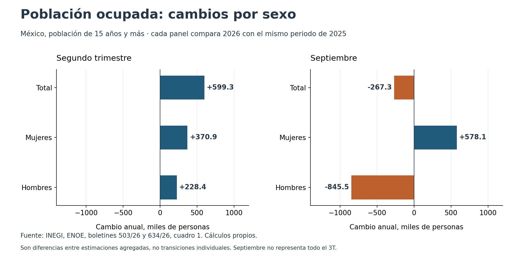

# Más ocupación no siempre implica mayor participación

La población ocupada, la participación económica y la desocupación responden a preguntas diferentes. El número de personas ocupadas mide un nivel; la participación compara la población económicamente activa (PEA) con la población de 15 años y más; la desocupación utiliza como denominador la propia PEA. Leer únicamente uno de estos indicadores puede ocultar cambios relevantes en los otros.

La muestra conserva dos comparaciones de la Encuesta Nacional de Ocupación y Empleo (ENOE), elaborada por el Instituto Nacional de Estadística y Geografía (INEGI): segundo trimestre de 2026 frente al mismo trimestre de 2025, y septiembre de 2026 frente al mismo mes de 2025. Los dos años de cada comparación proceden de una misma publicación. No se estima una serie continua entre ambas frecuencias.

## Segundo trimestre: el empleo aumenta y su proporción disminuye

Entre los segundos trimestres de 2025 y 2026, la ocupación aumentó 599,334 personas. La PEA creció 611,693, mientras que la población de referencia aumentó 1,689,822. Por ello, el incremento de la ocupación en personas coincidió con un descenso de su proporción respecto a la población de 15 años y más, de **57.93% a 57.56%**. La participación también bajó: las tasas publicadas son 59.5% y 59.1%; la diferencia calculada antes del redondeo es **−0.38 puntos porcentuales**.

No existe contradicción entre ambos movimientos. El denominador creció proporcionalmente más que el numerador. Esta constatación describe una relación entre agregados, sin determinar por qué aumentó la población fuera de la fuerza laboral.

Fuente: [INEGI, boletín 503/26, 25-ago-2026, cuadro 1, p. 3; tasas publicadas en cuadro 4, p. 9](https://www.inegi.org.mx/contenidos/saladeprensa/boletines/2026/enoe/enoe2026_08.pdf). Razones y diferencias propias a partir de los conteos.

## Septiembre: menos desocupación junto con menos ocupación

| Condición | Septiembre de 2025 | Septiembre de 2026 | Cambio, personas |
|---|---:|---:|---:|
| Población de 15 años y más | 104,239,840 | 105,617,240 | +1,377,400 |
| PEA | 62,094,108 | 61,735,269 | −358,839 |
| Ocupada | 60,244,382 | 59,977,049 | −267,333 |
| Desocupada | 1,849,726 | 1,758,220 | −91,506 |
| Fuera de la PEA | 42,145,732 | 43,881,971 | +1,736,239 |

Fuente: [INEGI, boletín 634/26, 22-oct-2026, cuadro 1, p. 4](https://www.inegi.org.mx/contenidos/saladeprensa/boletines/2026/iooe/IOE2026_10.pdf). Cambios: elaboración propia. Las filas contienen categorías anidadas, por lo que no deben sumarse todas entre sí.

La tasa de desocupación calculada disminuyó de 2.98% a 2.85%, pero también disminuyeron la ocupación y la participación. Esta última pasó de 59.57% a 58.45%. El resultado explica por qué una reducción de la desocupación no basta para caracterizar la evolución del empleo: el universo sobre el que se calcula también cambió.

La composición por sexo añade información. En septiembre, la ocupación de mujeres aumentó 578,137 personas y la de hombres disminuyó 845,470. En el segundo trimestre, ambos grupos registraron aumentos interanuales. Estas diferencias no permiten identificar a las mismas personas entre fechas ni atribuirles motivos de entrada o salida.

## Método reproducible

Sea $N$ la población de 15 años y más, $L$ la PEA, $E$ la ocupación y $U$ la desocupación. Se verifican las identidades $L=E+U$ y $N=L+\text{población fuera de la PEA}$. La participación es $p=L/N$; la razón ocupación/población es $E/N$; la tasa de desocupación es $U/L$. Para expresarlas en porcentaje se multiplican por 100.

El puente de la PEA descompone su cambio mediante la identidad simétrica:

$$
L_1-L_0=(N_1-N_0)\frac{p_1+p_0}{2}+(p_1-p_0)\frac{N_1+N_0}{2}.
$$

En septiembre, el término asociado al cambio de población es +812,806 personas y el asociado al cambio de participación, −1,171,645, redondeados. Su suma reproduce −358,839. Son componentes contables expresados en personas equivalentes; no son grupos de individuos observados ni efectos causales.

Las tasas se calculan con los conteos antes de redondear. Restar las tasas publicadas a una decimal puede dar una diferencia distinta: 3.0% menos 2.8% equivale a 0.2 puntos, mientras que la disminución calculada con los conteos de septiembre es 0.13 puntos. Los archivos distinguen las tasas publicadas de las calculadas.

## Alcance de la evidencia

Se emplean estimaciones nacionales agregadas y sus desgloses por sexo, sin ajuste estacional adicional. No se extraen errores estándar ni intervalos de confianza; por tanto, los cambios no se califican como estadísticamente significativos. No se suman periodos mensuales y trimestrales, no se extrapola septiembre al tercer trimestre y no se identifica el efecto de una reforma. La edición documental se conserva al 26-oct-2026; el cotejo del 13-nov-2026 confirmó los mismos PDF mediante SHA-256, sin actualizar el universo del análisis.
