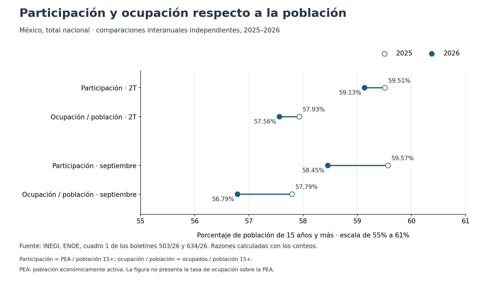

# México: empleo, participación y denominadores

**¿Cómo puede aumentar la ocupación y bajar al mismo tiempo la participación económica?** Esta muestra utiliza la Encuesta Nacional de Ocupación y Empleo (ENOE) del Instituto Nacional de Estadística y Geografía (INEGI) para distinguir los cambios en personas de los cambios en tasas.

En el segundo trimestre de 2026 había **599,334 personas ocupadas más** que un año antes, pero la participación disminuyó **0.38 puntos porcentuales**. La población de 15 años y más creció más que la población económicamente activa (PEA). En una comparación independiente, septiembre registró **267,333 personas ocupadas menos** que septiembre de 2025. Una tasa de desocupación menor, por sí sola, no resume esta segunda composición.

Fuente: [ENOE trimestral, boletín 503/26, cuadro 1, p. 3](https://www.inegi.org.mx/contenidos/saladeprensa/boletines/2026/enoe/enoe2026_08.pdf) y [ENOE mensual, boletín 634/26, cuadro 1, p. 4](https://www.inegi.org.mx/contenidos/saladeprensa/boletines/2026/iooe/IOE2026_10.pdf). Diferencias y razones: cálculos propios.



## Cobertura

| Dimensión | Alcance |
|---|---|
| Comparaciones | 2026-T2 frente a 2025-T2; septiembre de 2026 frente a septiembre de 2025, por separado |
| Universo | México, población de 15 años y más; total, mujeres y hombres publicados por INEGI |
| Datos mínimos | 12 registros: 60 conteos y 24 tasas publicadas |
| Unidades | Personas, porcentajes y diferencias en puntos porcentuales |
| Ajuste | Conteos y tasas de los cuadros publicados; no se aplica ajuste estacional adicional |
| Edición | Corte documental 26-oct-2026; PDF reconsultados y cotejados por SHA-256 el 13-nov-2026 |

Es una **muestra histórica congelada**, no un tablero con actualización automática ni una afirmación de contar con el último dato disponible.

## Leer y reproducir

- [Nota analítica en español](NOTE_ES.md): resultados, denominadores, método y límites.
- [English summary](SUMMARY_EN.md).
- [Datos mínimos](data/enoe_counts_and_rates.csv), [diccionario](DATA_DICTIONARY.md) y [fuentes con localizadores y SHA-256](data/sources.json).
- [Cambios interanuales](outputs/year_on_year_changes.csv), [tasas calculadas](outputs/rates_calculated.csv) y [puente contable de la PEA](outputs/labor_force_bridge.csv).

Desde esta carpeta, con Python 3.10 o posterior:

```bash
python -m pip install -r requirements.txt
python analyze.py
python validate.py
```

La ejecución funciona sin red una vez instalado Matplotlib. Si sólo se requieren tablas, `python analyze.py --no-charts` utiliza únicamente la biblioteca estándar. Dos figuras se guardan en PNG y SVG. La validación reproduce ocho archivos, compara los bytes entre modo normal, modo `-O` y archivos guardados, y rechaza ocho alteraciones de los insumos.

Para cotejar de nuevo las **84 celdas numéricas** con los PDF oficiales, instale Poppler (`pdftotext`) y utilice una caché fuera de esta carpeta:

```bash
python audit_sources.py --cache /ruta/fuera/de/esta/muestra/enoe_pdf --download
```

El cotejo se detiene si cambia el SHA-256 de una fuente. Los PDF y sus logotipos no forman parte de esta muestra. Resultados de la ejecución comprobada: [VALIDATION.json](VALIDATION.json) y [SOURCE_AUDIT.json](SOURCE_AUDIT.json).

## Interpretación y atribución

Las diferencias son descriptivas: no identifican flujos de las mismas personas, causas de inactividad, efectos de políticas ni significancia estadística. Septiembre no sustituye al tercer trimestre. La razón ocupados/población de 15 años y más tiene un denominador distinto de la tasa de ocupación sobre la PEA.

Datos agregados públicos: INEGI. Análisis, código y figuras: elaboración propia de Isaac Guzmán Valdivia Tovar. No se atribuye aval institucional. Se enlazan los [términos de uso de INEGI](https://www.inegi.org.mx/inegi/terminos.html); esta muestra no incluye microdatos ni registros personales.
